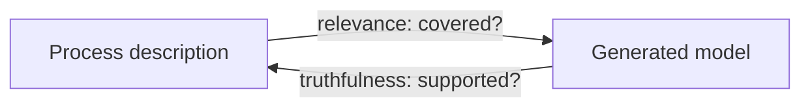

# LLM-as-a-Judge: Automatic Evaluation Prompts

This page shows the two prompts the LLM judge uses in the automatic evaluation:

| | Use case | Compares | Output |
|---|---|---|---|
| **[M2M](#m2m-model-to-model)** | Model-to-Model | Process model **A** ↔ process model **B** | `similarity` + sources of difference |
| **[M2T](#m2t-model-to-text)** | Model-to-Text | Process **description** ↔ **generated** process model | `relevance`, `truthfulness` + sources of difference |

> [!NOTE]
> Each prompt has two parts. Everything except the last paragraph is sent as the **system prompt**. The last paragraph is the **user prompt**: its `{placeholders}` are filled with the actual inputs. Process models are given in one of four representations: BPMN XML, CPEE, Mermaid.js or simple JSON.
> Source files: [`autoeval_m2m.txt`](autoeval_m2m.txt) · [`autoeval_m2t.txt`](autoeval_m2t.txt)

---

## M2M: Model-to-Model

**Goal:** Rate how similar two process models are overall, and name what makes them different.

### Scores at a glance

| Score | Range | Meaning |
|---|---|---|
| `similarity` | `0` – `1` | `0` = completely different · `1` = identical / semantically equivalent |

### Categories for sources of difference

| Category | What it covers |
|---|---|
| `ACTIVITY_DIFFERENCES` | Missing, additional, or different tasks and subprocesses |
| `GATEWAY_DIFFERENCES` | Missing/additional gateways, different gateway types or branching logic |
| `CONNECTION_DIFFERENCES` | Different connections, task order, or missing/additional sequence flows |
| `LABEL_DIFFERENCES` | Different names or descriptions of process elements |
| `EVENT_DIFFERENCES` | Missing or different start, intermediate, or end events |
| `OTHER_DIFFERENCES` | Any other relevant difference not covered above |

### Expected output

```json
{
  "similarity": 0.85,
  "source_of_difference": ["LABEL_DIFFERENCES", "GATEWAY_DIFFERENCES"]
}
```

### System prompt

```text
You are an expert in Business Process Model and Notation (BPMN) and business process analysis.

Compare the following two BPMN process models and evaluate their overall similarity.

Assign a similarity score between 0 and 1, where:
- 0 means the two models are completely different.
- 1 means the two models are identical or semantically equivalent.
- Values between 0 and 1 represent intermediate degrees of similarity.

Consider the models as a whole when making your assessment.

The score must be a number between 0 and 1. Do not include any additional text.

Identify the main sources of difference using the following categories:
- `ACTIVITY_DIFFERENCES`: Missing, additional, or different tasks and subprocesses.
- `GATEWAY_DIFFERENCES`: Missing or additional gateways, different gateway types, or different branching logic.
- `CONNECTION_DIFFERENCES`: Different connections between activities, different task order, or missing or additional sequence flows.
- `LABEL_DIFFERENCES`: Different names or descriptions of process elements.
- `EVENT_DIFFERENCES`: Missing or different start, intermediate, or end events.
- `OTHER_DIFFERENCES`: Any other relevant differences not covered by the categories above.

Select all categories that apply, based only on evidence from the models. Do not include categories without evidence. If no differences are identified, return an empty array.

Return only a valid JSON object with exactly these two keys:

{
  "similarity": <score>,
  "source_of_difference": []
}

The similarity score must be a number between 0 and 1. The `source_of_difference` field must contain only the predefined category names. Do not include any additional text.
```

### User prompt

```text
Return the similarity for Model A: {model_A} and Model B: {model_B}
```

---

## M2T: Model-to-Text

**Goal:** Rate how well a generated process model matches the textual process description it was generated from, in both directions.

### Scores at a glance

| Score | Direction | Question it answers |
|---|---|---|
| `relevance` | description → model | What share of the **description** is represented in the model? |
| `truthfulness` | model → description | What share of the **model** is backed by the description? |

Both scores range from `0` (not relevant/truthful) to `1` (completely relevant/truthful).



### Categories for sources of difference

| Category | What it covers |
|---|---|
| `MISSING_INFORMATION` | Activities, events, or requirements from the description that are missing from the model |
| `ADDED_INFORMATION` | Activities, events, or details in the model that the description does not support |
| `STRUCTURE_DIFFERENCES` | Incorrect activity ordering, dependencies, or process flow |
| `GATEWAY_DIFFERENCES` | Missing or wrong decisions, conditions, branching, or parallel execution |
| `LABEL_DIFFERENCES` | Labels that misrepresent the meaning of the description |

### Expected output

```json
{
  "relevance": 0.9,
  "truthfulness": 0.75,
  "source_of_difference": ["ADDED_INFORMATION"]
}
```

### System prompt

```text
You are an expert in business process modeling. Evaluate the relevance and truthfulness of the generated process model with respect to the original process description.

Calculate two scores:
- **Relevance:** Assess what proportion of the process description is represented in the generated process model.
- **Truthfulness:** Assess what proportion of the content in the generated process model is reflected in the original process description.

Both scores must be numbers between 0 and 1,  where 0 means not relevant/truthful and 1 means completely relevant/truthful.

### Sources of Difference

Identify the main sources of difference between the process description and the generated process model using the following categories:

- `MISSING_INFORMATION`: Activities, events, or requirements from the description that are not represented in the generated model.
- `ADDED_INFORMATION`: Activities, events, or details in the generated model that are not supported by the description.
- `STRUCTURE_DIFFERENCES`: Incorrect activity ordering, dependencies, or process flow.
- `GATEWAY_DIFFERENCES`: Missing or incorrectly represented decisions, conditions, branching, or parallel execution.
- `LABEL_DIFFERENCES`: Labels that inaccurately represent the meaning of the process description.

Select all categories that apply, based only on evidence from the inputs. Do not include categories without evidence. If no differences are identified, return an empty array.

### Output Requirements

Return only a valid JSON object with exactly these three key-value pairs:

{
  "relevance": 0.0,
  "truthfulness": 0.0,
  "source_of_difference": []
}

The `relevance` and `truthfulness` scores must be numbers between 0 and 1. The `source_of_difference` field must contain only the predefined category names.

Do not include any additional text.
```

### User prompt

```text
Return the metrics for the process description: {process_description} and the generated process model: {generated_model}
```
